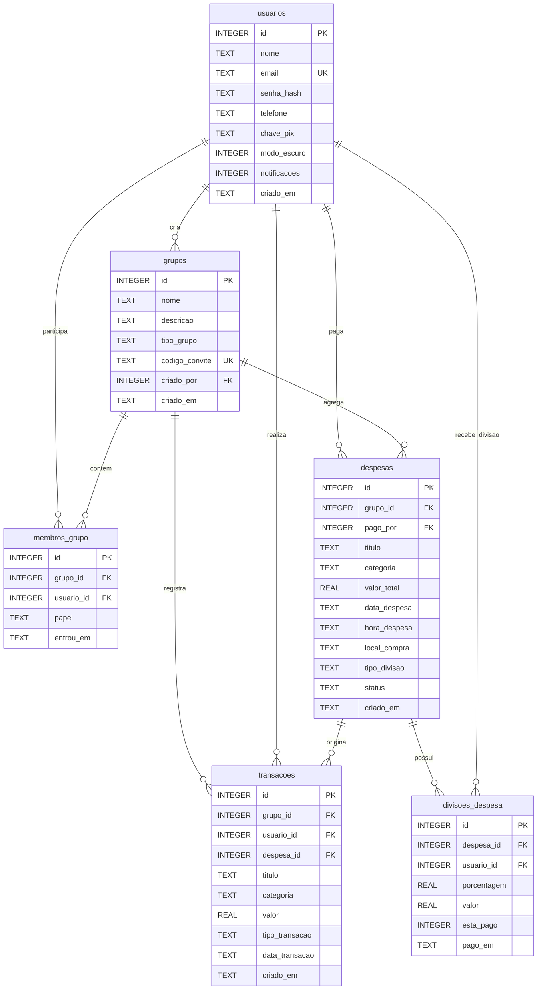

# Documentação Técnica e Arquitetural do Sistema CoinShare

**CENTRO ESTADUAL DE EDUCAÇÃO TECNOLÓGICA "PAULA SOUZA"**  
**FACULDADE DE TECNOLOGIA DE TAQUARITINGA (FATEC)**  
**CURSO SUPERIOR DE TECNOLOGIA EM ANÁLISE E DESENVOLVIMENTO DE SISTEMAS**  
**PROJETO INTEGRADOR – COINSHARE**

*Continuação oficial do documento de escopo e especificação do sistema.*

---

## Sumário
- [1. Visão Geral e Contexto](#1-visão-geral-e-contexto)
- [2. Tecnologias Utilizadas e Justificativa Técnica](#2-tecnologias-utilizadas-e-justificativa-técnica)
- [3. Arquitetura do Sistema](#3-arquitetura-do-sistema)
- [4. Modelagem do Banco de Dados](#4-modelagem-do-banco-de-dados)
  - [4.1 Diagrama Entidade-Relacionamento (DER)](#41-diagrama-entidade-relacionamento-der)
  - [4.2 Dicionário de Dados Detalhado (Tabelas e Atributos em Português)](#42-dicionário-de-dados-detalhado)
- [5. Catálogo de Rotas e Endpoints da API REST](#5-catálogo-de-rotas-e-endpoints-da-api-rest)
- [6. Regras de Negócio e Algoritmos Implementados](#6-regras-de-negócio-e-algoritmos-implementados)
  - [6.1 Divisão Igualitária vs. Desigual (Personalizada)](#61-divisão-igualitária-vs-desigual)
  - [6.2 Algoritmo de Balanço e Acerto de Contas (Quem Deve Para Quem)](#62-algoritmo-de-balanço-e-acerto-de-contas)
  - [6.3 Relatórios e Métricas de Conformidade](#63-relatórios-e-métricas-de-conformidade)
  - [6.4 Persistência de Sessão e Estado](#64-persistência-de-sessão-e-estado)
- [7. Padrões de Projeto e Nomenclatura em Português](#7-padrões-de-projeto-e-nomenclatura-em-português)
- [8. Guia de Instalação, Execução e Testes](#8-guia-de-instalação-execução-e-testes)

---

## 1. Visão Geral e Contexto

O **CoinShare** é uma aplicação web completa voltada para a gestão colaborativa e divisão transparente de despesas em grupos (como repúblicas estudantis, viagens entre amigos, eventos e custos familiares).

O sistema resolve a barreira linguística e as limitações de ferramentas proprietárias internacionais (como o Splitwise), oferecendo uma experiência 100% em português brasileiro, integração visual com pagamentos via Pix, visualização em tempo real de quem deve para quem e relatórios analíticos interativos.

---

## 2. Tecnologias Utilizadas e Justificativa Técnica

A escolha das tecnologias baseou-se nos princípios de **leveza, independência de dependências externas pesadas, aderência aos padrões web fundamentais e facilidade de manutenção e implantação**.

| Camada | Tecnologia | Justificativa Técnica |
| :--- | :--- | :--- |
| **Frontend - Estrutura** | **HTML5 Semântico** | Uso de tags estruturais (`<header>`, `<nav>`, `<main>`, `<section>`, `<article>`, `<aside>`) para acessibilidade, SEO, clareza hierárquica e fácil manutenção. Todos os IDs e classes nomeados em português. |
| **Frontend - Estilização** | **Vanilla CSS3 Moderno** | **100% externo, com zero estilos inline (`style="..."`)**. Utiliza *Custom Properties* (variáveis CSS) para temas claro e escuro, layout responsivo com *Flexbox* e *CSS Grid*, e *Media Queries* fluidas para adaptação imediata entre smartphones, tablets e telas desktop ultrawide. |
| **Frontend - Lógica** | **JavaScript Puro (ES6+)** | Manipulação dinâmica do DOM sem a sobrecarga de frameworks como React ou Angular. Utiliza a **Fetch API assíncrona** com `async/await` para comunicação com o backend e renderização de gráficos interativos nativos em SVG. Todas as variáveis e funções seguem a nomenclatura em português. |
| **Backend - Servidor & API** | **Python 3 + Flask** | Microframework robusto, de alta performance e rápida inicialização, ideal para arquiteturas orientadas a microsserviços e APIs RESTful limpas. Facilidade para manipulação de dados numéricos e regras financeiras. |
| **Segurança e Criptografia** | **Werkzeug Security** | Criptografia irreversível de senhas com algoritmo seguro de derivação de chaves (`generate_password_hash` com PBKDF2/SHA-256 e `check_password_hash`), impedindo armazenamento de credenciais em texto puro. |
| **Banco de Dados** | **SQLite3 Relacional** | Banco de dados relacional embarcado no backend, compatível com a especificação ACID. Não requer instalação de servidores adicionais (como MySQL ou PostgreSQL) para rodar o projeto localmente, facilitando a distribuição e testes acadêmicos. |

---

## 3. Arquitetura do Sistema

O sistema adota uma arquitetura baseada no modelo **Cliente-Servidor (Client-Server Architecture)** com desacoplamento total entre o Frontend e o Backend:

```
┌──────────────────────────────────────────────────────────────┐
│                    CLIENTE (Navegador Web)                   │
│                                                              │
│  [index.html]  ──>  [style.css (Variáveis, Grid, Responsivo)]│
│         │                                                    │
│         └───>  [app.js (Lógica de Telas, Validações, Estado)]│
└───────────────────────────────┬──────────────────────────────┘
                                │
                                │ Requisições HTTP (JSON / REST)
                                │ [GET, POST, PUT, DELETE]
                                ▼
┌──────────────────────────────────────────────────────────────┐
│                    SERVIDOR (Python / Flask)                 │
│                                                              │
│                     [server.py]                              │
│       ├── Roteamento de API REST (/api/...)                  │
│       ├── Hash de Senhas e Segurança                         │
│       ├── Algoritmo de Acerto de Contas                      │
│       └── Camada de Acesso a Dados                           │
└───────────────────────────────┬──────────────────────────────┘
                                │
                                │ Consultas SQL (Driver nativo)
                                ▼
┌──────────────────────────────────────────────────────────────┐
│                  BANCO DE DADOS (coinshare.db)               │
│                                                              │
│   [usuarios] ── [grupos] ── [membros_grupo]                 │
│         └─── [despesas] ── [divisoes_despesa] ── [transacoes]│
└──────────────────────────────────────────────────────────────┘
```

- **Comunicação Assíncrona**: O frontend nunca recarrega a página inteira ao realizar ações (como criar despesas, pagar contas ou trocar de grupo); todas as operações ocorrem via `fetch()` assíncrono com feedback imediato via notificações (*toasts*).
- **Persistência de Sessão**: Uso do `localStorage` para manter o usuário logado e restaurar seu grupo ativo e tela atual após recarregamentos acidentais.

---

## 4. Modelagem do Banco de Dados

### 4.1 Diagrama Entidade-Relacionamento (DER)



---

### 4.2 Dicionário de Dados Detalhado

Todos os nomes das tabelas e seus respectivos atributos estão **padronizados em português**.

#### 1. Tabela: `usuarios`
Armazena as credenciais e configurações de perfil de cada usuário cadastrado.

| Atributo | Tipo de Dado | Restrições | Descrição |
| :--- | :--- | :--- | :--- |
| `id` | `INTEGER` | Chave Primária, Auto Incremento | Identificador único do usuário. |
| `nome` | `TEXT` | `NOT NULL` | Nome completo do usuário. |
| `email` | `TEXT` | `NOT NULL`, `UNIQUE` | E-mail corporativo ou pessoal usado para autenticação. |
| `senha_hash` | `TEXT` | `NOT NULL` | Hash criptográfico seguro da senha gerado com PBKDF2/SHA-256. |
| `telefone` | `TEXT` | Opcional | Número de contato do usuário. |
| `chave_pix` | `TEXT` | Opcional | Chave Pix cadastrada para recebimento de ressarcimentos. |
| `modo_escuro` | `INTEGER` | `DEFAULT 0` | Booleano (0 = Claro, 1 = Modo Escuro ativado). |
| `notificacoes`| `INTEGER` | `DEFAULT 1` | Booleano (1 = Recebe notificações, 0 = Desativado). |
| `criado_em` | `TEXT` | `DEFAULT CURRENT_TIMESTAMP` | Data e hora de criação da conta no sistema. |

---

#### 2. Tabela: `grupos`
Registra os grupos criados para organizar as despesas compartilhadas.

| Atributo | Tipo de Dado | Restrições | Descrição |
| :--- | :--- | :--- | :--- |
| `id` | `INTEGER` | Chave Primária, Auto Incremento | Identificador único do grupo. |
| `nome` | `TEXT` | `NOT NULL` | Nome do grupo (ex: "República Centro", "Viagem Ubatuba"). |
| `descricao` | `TEXT` | Opcional | Breve descrição da finalidade do grupo. |
| `tipo_grupo` | `TEXT` | `DEFAULT 'fechado'` | Tipo de acesso: `'fechado'` (somente convite) ou `'aberto'` (via link). |
| `codigo_convite` | `TEXT` | `UNIQUE` | Código alfanumérico gerado para convite de participantes. |
| `criado_por` | `INTEGER` | Chave Estrangeira (`usuarios.id`) | Usuário criador/administrador inicial do grupo. |
| `criado_em` | `TEXT` | `DEFAULT CURRENT_TIMESTAMP` | Data e horário de fundação do grupo. |

---

#### 3. Tabela: `membros_grupo`
Tabela associativa que gerencia os participantes vinculados a cada grupo.

| Atributo | Tipo de Dado | Restrições | Descrição |
| :--- | :--- | :--- | :--- |
| `id` | `INTEGER` | Chave Primária, Auto Incremento | Identificador do vínculo membro-grupo. |
| `grupo_id` | `INTEGER` | `NOT NULL`, FK (`grupos.id`) | Grupo ao qual o usuário pertence. |
| `usuario_id` | `INTEGER` | `NOT NULL`, FK (`usuarios.id`) | Usuário participante. |
| `papel` | `TEXT` | `DEFAULT 'membro'` | Papel no grupo: `'admin'` ou `'membro'`. |
| `entrou_em` | `TEXT` | `DEFAULT CURRENT_TIMESTAMP` | Data de inclusão no grupo. |

*Restrição de Integridade*: `UNIQUE(grupo_id, usuario_id)` impede duplicidade de um mesmo membro no mesmo grupo.

---

#### 4. Tabela: `despesas`
Registra as compras, gastos e despesas lançadas no grupo.

| Atributo | Tipo de Dado | Restrições | Descrição |
| :--- | :--- | :--- | :--- |
| `id` | `INTEGER` | Chave Primária, Auto Incremento | Identificador único da despesa. |
| `grupo_id` | `INTEGER` | `NOT NULL`, FK (`grupos.id`) | Grupo onde a despesa ocorreu. |
| `pago_por` | `INTEGER` | `NOT NULL`, FK (`usuarios.id`) | Membro que arcou inicialmente com o pagamento integral. |
| `titulo` | `TEXT` | `NOT NULL` | Título ou descrição da compra (ex: "Almoço FT", "Aluguel"). |
| `categoria` | `TEXT` | `DEFAULT 'Outros'` | Categoria do gasto (Alimentação, Moradia, Mercado, Transporte, etc.). |
| `valor_total` | `REAL` | `NOT NULL` | Valor monetário total da despesa em reais (R$). |
| `data_despesa` | `TEXT` | `NOT NULL` | Data em que a despesa foi realizada (formato ISO `AAAA-MM-DD`). |
| `hora_despesa` | `TEXT` | `DEFAULT '12:00'` | Horário da transação. |
| `local_compra` | `TEXT` | Opcional | Estabelecimento ou local físico/virtual da compra. |
| `tipo_divisao` | `TEXT` | `DEFAULT 'igual'` | Modelo de cálculo da divisão: `'igual'` ou `'desigual'`. |
| `status` | `TEXT` | `DEFAULT 'pendente'` | Status geral da despesa: `'pago'`, `'pendente'` ou `'atrasado'`. |
| `criado_em` | `TEXT` | `DEFAULT CURRENT_TIMESTAMP` | Data e hora de inclusão do registro no banco de dados. |

---

#### 5. Tabela: `divisoes_despesa`
Detalha a fatia exata de responsabilidade de cada membro em uma determinada despesa.

| Atributo | Tipo de Dado | Restrições | Descrição |
| :--- | :--- | :--- | :--- |
| `id` | `INTEGER` | Chave Primária, Auto Incremento | Identificador único do rateio. |
| `despesa_id` | `INTEGER` | `NOT NULL`, FK (`despesas.id`) | Despesa vinculada. |
| `usuario_id` | `INTEGER` | `NOT NULL`, FK (`usuarios.id`) | Membro que deve essa parcela. |
| `porcentagem` | `REAL` | `NOT NULL` | Porcentagem atribuída ao participante (ex: 50.0 para 50%). |
| `valor` | `REAL` | `NOT NULL` | Valor exato em reais atribuído ao participante. |
| `esta_pago` | `INTEGER` | `DEFAULT 0` | Booleano: 1 se a sua parte já foi quitada, 0 se pendente. |
| `pago_em` | `TEXT` | Opcional | Data e hora em que a quitação foi confirmada. |

> **Regra de Negócio Fundamental**: Quem registra a despesa é sempre o **recebedor** (quem arcou com o pagamento integral). Sua respectiva cota em `divisoes_despesa` é registrada automaticamente como **quitada (`esta_pago = 1`)**, visto que ele já pagou sua parte na compra e não pode pagar a si mesmo. Na interface, a despesa é exibida como **PAGO** para o recebedor, ocultando o botão de pagamento.

---

#### 6. Tabela: `transacoes`
Mantém o extrato e a linha do tempo histórica de entradas e saídas de valores no grupo.

| Atributo | Tipo de Dado | Restrições | Descrição |
| :--- | :--- | :--- | :--- |
| `id` | `INTEGER` | Chave Primária, Auto Incremento | Identificador da transação financeira. |
| `grupo_id` | `INTEGER` | `NOT NULL`, FK (`grupos.id`) | Grupo relacionado. |
| `usuario_id` | `INTEGER` | `NOT NULL`, FK (`usuarios.id`) | Participante responsável pela movimentação. |
| `despesa_id` | `INTEGER` | Opcional, FK (`despesas.id`) | Despesa que deu origem ao registro (se aplicável). |
| `titulo` | `TEXT` | `NOT NULL` | Descritivo da transação. |
| `categoria` | `TEXT` | `NOT NULL` | Categoria contábil. |
| `valor` | `REAL` | `NOT NULL` | Valor transacionado. |
| `tipo_transacao` | `TEXT` | `NOT NULL` | Tipo da movimentação: `'entrada'` (recebimento/pagamento) ou `'saida'` (gasto). |
| `data_transacao` | `TEXT` | `DEFAULT CURRENT_TIMESTAMP` | Data em que a movimentação foi registrada. |
| `criado_em` | `TEXT` | `DEFAULT CURRENT_TIMESTAMP` | Data do registro. |

---

## 5. Catálogo de Rotas e Endpoints da API REST

Todas as rotas da API foram desenvolvidas em português e possuem aliases de compatibilidade para garantir robustez:

| Método | Endpoint em Português | Alias | Descrição |
| :--- | :--- | :--- | :--- |
| `POST` | `/api/autenticacao/cadastrar` | `/api/auth/register` | Cria um novo usuário com nome, e-mail e senha criptografada. |
| `POST` | `/api/autenticacao/login` | `/api/auth/login` | Autentica o usuário e retorna seus dados de perfil e grupo ativo. |
| `POST` | `/api/autenticacao/login-social` | `/api/auth/social-login` | Endpoint reservado para provedores sociais (interface do usuário marcada como 'Em breve'). |
| `PUT` | `/api/autenticacao/perfil` | `/api/auth/profile` | Atualiza nome, telefone, chave Pix, preferências ou senha do usuário. |
| `GET` | `/api/grupos?usuario_id=:id` | `/api/groups` | Lista todos os grupos dos quais o usuário informado participa. |
| `POST` | `/api/grupos` | `/api/groups` | Cria um novo grupo fechado ou aberto com código de convite único. |
| `GET` | `/api/grupos/:id/painel` | `/api/groups/:id/dashboard` | Retorna resumo financeiro, saldo, membros e despesas recentes. |
| `GET` | `/api/grupos/:id/despesas` | `/api/groups/:id/expenses` | Lista todas as despesas lançadas no grupo com seus respectivos status. |
| `POST` | `/api/grupos/:id/despesas` | `/api/groups/:id/expenses` | Lança uma nova compra com rateio igual ou desigual entre participantes. |
| `GET` | `/api/despesas/:id` | `/api/expenses/:id` | Retorna o detalhamento completo de uma despesa e suas frações por membro. |
| `PUT` | `/api/despesas/:id` | `/api/expenses/:id` | Atualiza os dados de uma despesa existente (título, categoria, valor, local) e recalcula divisões. |
| `DELETE` | `/api/despesas/:id` | `/api/expenses/:id` | Exclui permanentemente uma despesa, suas divisões e transações vinculadas. |
| `POST` | `/api/despesas/:id/pagar` | `/api/expenses/:id/pay` | Registra a quitação total ou parcial da parcela devida em uma despesa. |
| `GET` | `/api/grupos/:id/acertos` | `/api/groups/:id/settlements` | Retorna o balanço geral consolidado e a lista simplificada de quem deve para quem. |
| `POST` | `/api/grupos/:id/acertos/liquidar` | `/api/groups/:id/settlements/settle` | Dá baixa e liquida o acerto de contas entre devedor e credor, quitando as divisões de despesa e registrando a transação. |
| `GET` | `/api/grupos/:id/relatorios` | `/api/groups/:id/reports` | Gera os dados estatísticos para gráficos por membro, por categoria e conformidade. |
| `GET` | `/api/grupos/:id/transacoes` | `/api/groups/:id/transactions` | Lista o extrato cronológico filtrado por entradas, saídas ou todo o período. |
| `POST` | `/api/grupos/:id/membros` | `/api/groups/:id/members` | Adiciona um novo participante existente ao grupo especificado. |
| `GET` | `/api/usuarios/buscar?q=:termo` | `/api/users/search` | Busca usuários cadastrados por nome ou e-mail para inclusão em grupos. |

---

## 6. Regras de Negócio e Algoritmos Implementados

### 6.1 Divisão Igualitária vs. Desigual
- **Divisão Igualitária (`igual`)**: O sistema divide o montante total da despesa pelo número total de participantes do grupo:
  $$\text{Valor por Membro} = \frac{\text{Valor Total}}{N}$$
  O participante que realizou o pagamento inicial tem sua parcela automaticamente marcada como quitada (`esta_pago = 1`), enquanto as parcelas dos demais membros ficam como pendentes.
- **Divisão Desigual (`desigual`)**: Os participantes ajustam porcentagens customizadas em tabela dinâmica. O sistema valida se a soma das porcentagens totaliza rigorosamente $100\%$, calculando a fatia individual:
  $$\text{Valor do Membro } i = \text{Valor Total} \times \left(\frac{\text{Porcentagem}_i}{100}\right)$$

### 6.2 Algoritmo de Balanço e Acerto de Contas (Sensível ao Papel do Usuário)
Para eliminar a confusão de pagamentos cruzados, o sistema calcula o **saldo líquido** de cada participante:
$$\text{Saldo Líquido}_i = \text{Total Pago pelo Usuário}_i - \text{Total Devido pelo Usuário}_i$$

- **Credores** ($\text{Saldo} > 0$): Usuários que pagaram mais do que consumiram.
- **Devedores** ($\text{Saldo} < 0$): Usuários que consumiram mais do que pagaram.

O algoritmo emparelha o maior devedor com o maior credor até liquidar o balanço com o menor número possível de transferências monetárias.

**Ações Dinâmicas por Papel no Acerto de Contas**:
- **Visão do Credor (quem deve receber)**: Quando um participante deve para o usuário logado, o botão exibido é **"MARCAR COMO PAGO"** (dar baixa). Ao clicar, o credor confirma o recebimento do valor via Pix/dinheiro; a API liquida as divisões correspondentes no banco de dados e atualiza o balanço em tempo real para ambos os usuários.
- **Visão do Devedor (quem deve pagar)**: Quando o usuário logado deve para outro participante, o botão exibido é **"PAGAR AGORA"**, com cópia da chave Pix em 1 clique e modal de pagamento.
- **Visão de Terceiros**: Participantes neutros visualizam apenas o selo informativo **"PENDENTE"**, sem botões indevidos de ação.

### 6.3 Relatórios e Métricas de Conformidade
- **Distribuição de Compras**: Gráfico Donut em SVG responsivo calcula o percentual de gastos por participante e por categoria de consumo (Alimentação, Moradia, Lazer, etc.).
- **Índice de Conformidade de Pagamento**:
  $$\text{Índice de Adimplência} = \left(\frac{\text{Dívidas Quitadas}}{\text{Total de Dívidas Atribuídas}}\right) \times 100\%$$
  Classificado visualmente em:
  - **Alta Conformidade** ($\ge 80\%$): Destaque verde.
  - **Média Conformidade** ($50\% - 79\%$): Destaque amarelo.
  - **Baixa Conformidade** ($< 50\%$): Alerta vermelho.

### 6.4 Persistência de Sessão e Estado
Para evitar redirecionamentos indesejados para a tela de autenticação durante o uso ou após recarregamentos acidentais (F5), a aplicação salva o estado no `localStorage`:
- Usuário logado (`coinshare_usuario`)
- Identificador do grupo ativo selecionado (`coinshare_grupo_id_ativo`)
- Tela em exibição (`coinshare_tela_atual`)

---

## 7. Padrões de Projeto e Nomenclatura em Português

Em atendimento integral às diretrizes do projeto acadêmico:
1. **HTML e CSS**:
   - Todas as tags, classes e IDs utilizam nomes descritivos em português (ex: `cabecalho-navegacao-desktop`, `tela-acerto-contas`, `botao-salvar-despesa`, `entrada-formulario`, `cartao-principal-detalhe`).
   - Não há estilos inline; todas as regras estéticas residem em `style.css`.
2. **JavaScript**:
   - Todas as variáveis e funções foram batizadas em português claro (ex: `carregarPainel()`, `formatarMoeda()`, `submeterNovaDespesa()`, `abrirDetalhesDespesa()`, `estado`).
3. **Banco de Dados**:
   - Nomes de tabelas em português (`usuarios`, `grupos`, `membros_grupo`, `despesas`, `divisoes_despesa`, `transacoes`).
   - Atributos e colunas em português (`valor_total`, `tipo_divisao`, `chave_pix`, `modo_escuro`, `pago_por`, etc.).

---

## 8. Guia de Instalação, Execução e Testes

### Requisitos Prévios
- **Python 3.8+** instalado.
- Navegador web moderno (Chrome, Edge, Firefox, Safari ou Opera).

### Passo a Passo de Execução

1. **Instalar dependências**:
   ```bash
   pip install Flask
   ```

2. **Iniciar o Servidor Backend (API)**:
   Na pasta raiz do projeto, execute:
   ```bash
   python server.py
   ```
   *O banco de dados SQLite (`coinshare.db`) será verificado e inicializado automaticamente com as tabelas em português na primeira execução.*

3. **Acessar a Aplicação**:
   Abra o seu navegador web no endereço:
   ```
   http://127.0.0.1:5000/
   ```

4. **Execução de Testes Automatizados da API**:
   Para validar os endpoints e a integridade das regras de negócio, execute:
   ```bash
   python -c "import urllib.request, json; resp = urllib.request.urlopen('http://127.0.0.1:5000/api/grupos'); print('Status API:', resp.status)"
   ```

---
*CoinShare – Finanças Coletivas Simplificadas © 2026. Faculdade de Tecnologia de Taquaritinga.*
